## Hola, soy Mariano

**Analista de Sistemas en formación (3er año)** · Buenos Aires, Argentina

Tengo un perfil proactivo, con base en soporte técnico y mantenimiento de sistemas, y hoy estoy enfocado en el desarrollo con Python: APIs, bases de datos e Inteligencia Artificial. Mi objetivo es aportar valor en entornos tecnológicos desafiantes.

---

## Stack

**Lenguajes y web**

**Backend y APIs**

**Bases de datos**

**Inteligencia Artificial**

**Herramientas y metodologías**

---

## Proyecto destacado

### Chatbot con IA
*Prácticas profesionalizantes · Instituto Técnico Industrial San Judas Tadeo · 03/2025 – 12/2025*

Asistente virtual basado en Inteligencia Artificial, desarrollado en Python para optimizar la interacción con usuarios.

- Búsqueda detallada de información (precios, stock) sobre una base de datos MySQL.
- Integración de LangChain y Ollama.
- Conexión vía WhatsApp para acceso directo y mayor eficiencia en las consultas.

---

## Experiencia

| Rol | Lugar | Período |
|---|---|---|
| **Tutor de Programación** (part-time) | Lifecole® | 04/2025 – Actualidad |
| **Mantenimiento de equipos informáticos** | Instituto Técnico Industrial San Judas Tadeo | 03/2022 – 12/2022 |

**Tutor de Programación:** enseñanza de las bases de la programación e introducción a los lenguajes más utilizados (HTML, CSS y JavaScript).

**Mantenimiento de equipos:** reparación de máquinas, instalación de programas, limpieza y armado de PC.

---

## Formación

| Título | Institución | Período |
|---|---|---|
| **Analista en Sistemas** | Instituto Técnico Industrial San Judas Tadeo | 2023 – Actualidad |
| **Secundario Técnico en Informática** | Instituto Técnico Industrial San Judas Tadeo | 2016 – 2022 |
